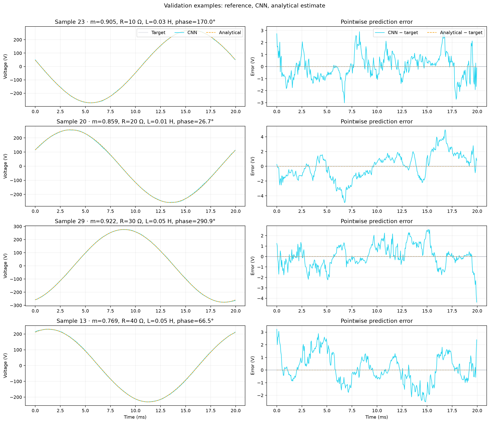
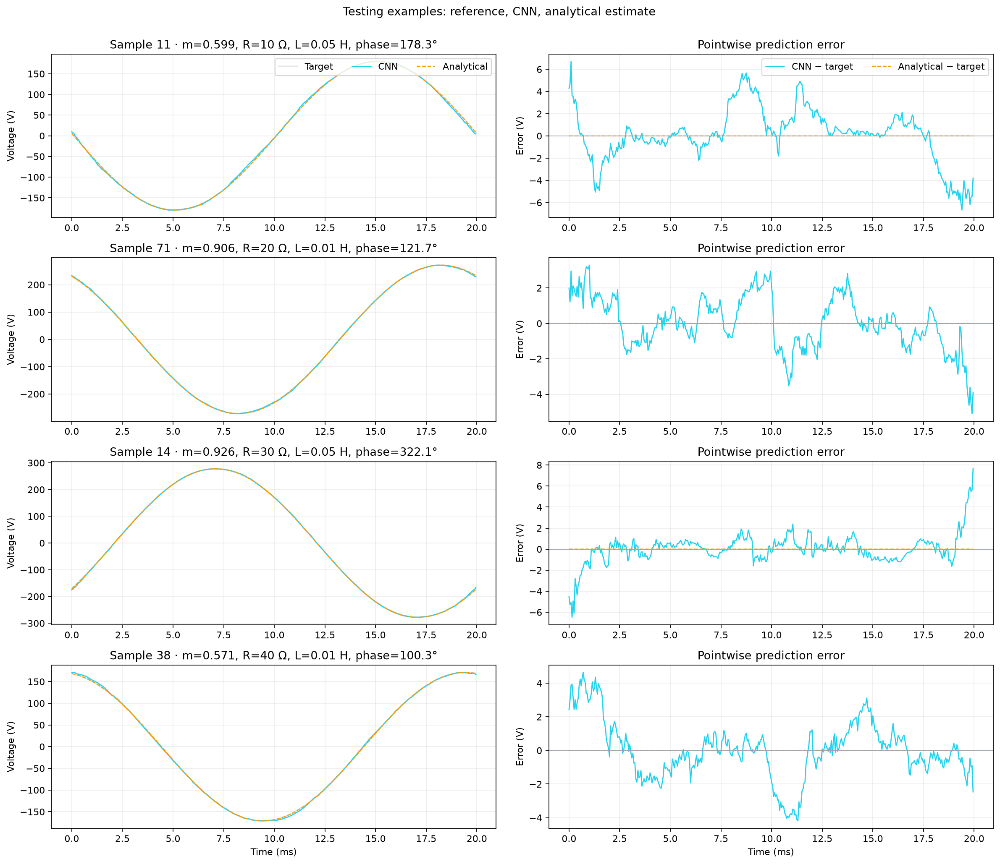
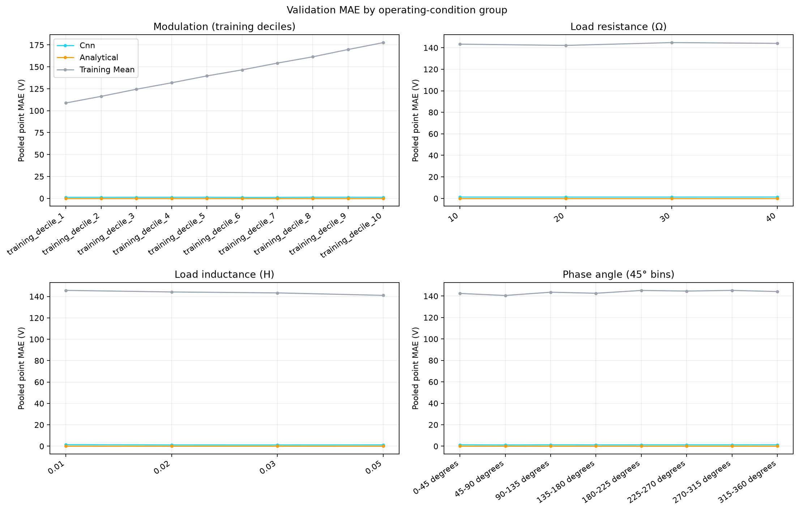
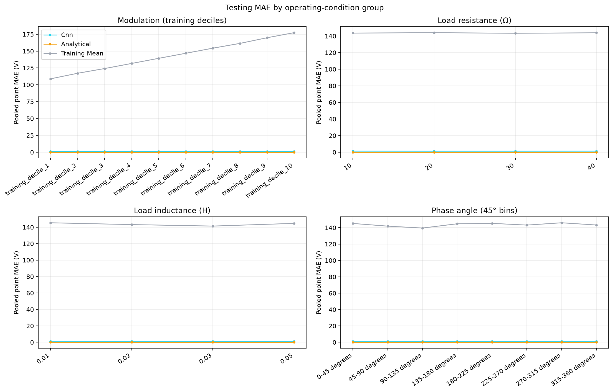

# CNN vs Analytical Reference Evaluation

**Run timestamp:** 2026-11-20T22:14:33.201120+05:30  
**Dataset:** `C:\Users\tejas m naidu\OneDrive\Hybrid_CNN_Inverter_Optimization-20261120T100441Z-1-001\Hybrid_CNN_Inverter_Optimization\data\raw\Seven_Level_Inverter_Project_extracted`  
**Checkpoint:** `C:\Users\tejas m naidu\OneDrive\Hybrid_CNN_Inverter_Optimization-20261120T100441Z-1-001\Hybrid_CNN_Inverter_Optimization\colab_runs\baseline_20261120_080836\checkpoints\best.pt`  
**Inference device:** `cpu`; batch size `64`  
**Reproducible outputs:** [`results/cnn_vs_analytical_20261120_2209/`](./results/cnn_vs_analytical_20261120_2209/)

## Result in brief

Validation pooled RMSE selected **analytical** as the best of the evaluated fixed predictors. No model weights, hyperparameters, or analytical equation were selected or tuned using the testing split. The test split is reported once as the final held-out comparison.

The analytical reference is more accurate on the final test split: its pooled RMSE is lower by 1.62227273 V. The CNN does not provide measurable prediction accuracy value over the known analytical target equation in this dataset.

## Inspection and provenance

- The saved model is `WaveformResidualCNN`, a separate 1D residual branch for input voltage and load current, with a condition encoder fused into residual convolution blocks. The checkpoint was loaded strictly against its stored model configuration.
- Checkpoint architecture: 400-point waveforms; two residual branches with 32/64 channels; four operating-condition inputs encoded to width 32; 64-channel fusion blocks; kernel size 5. The selected checkpoint is from epoch 98.
- Checkpoint parameter count: **201,601**.
- Dataset tables are aligned by `SampleID`; the stored input, target, and operating-condition normalization was checked against statistics refit from training records only.
- Dataset split sizes: **7,000 training / 1,500 validation / 1,500 testing**.
- CNN inference ran in evaluation mode under `torch.inference_mode()`; checkpoint weights were not modified and no training or fine-tuning ran.
- Checkpoint SHA-256: `9ffea39995c4bbba15f1f3572c9aaf54d49ad6ff1b1a186c4cafffe38263636c`.
- Source dataset CSV SHA-256 values are recorded in [`summary.json`](./results/cnn_vs_analytical_20261120_2209/summary.json).
- The project contains no original MATLAB/source dataset generator file. The analytical reference used by the existing scientific validation code is:

  `Vref[n] = 3 × 100 V × m × sin(2π × 50 Hz × n/20,000 Hz + phaseAngleRadians)`, for `n=0..399`.

  This estimate uses modulation index and phase angle only. It is compared with the stored `Target_Voltage.csv`; it does not use target values to construct its prediction.

## Metrics

Pooled metrics flatten all waveform points within each split. The per-record means and medians are reported in `summary.json`; per-record metrics for all three predictors are in [`per_record_metrics.csv`](./results/cnn_vs_analytical_20261120_2209/per_record_metrics.csv). R² and correlation shown below are computed across pooled points, not averaged recordwise.

| Split | Approach | MAE (V) | RMSE (V) | R² | Correlation | Max absolute error (V) |
|---|---|---:|---:|---:|---:|---:|
| training | CNN | 1.20052151 | 1.59427651 | 0.9999015885859732 | 0.9999508006365981 | 20.0048904 |
| training | Analytical | 1.34736414e-05 | 1.78856013e-05 | 0.9999999999999876 | 0.9999999999999958 | 8.96531925e-05 |
| training | Training mean | 143.022472 | 160.70316 | 7.596720028590909e-05 | 0.008715916491445425 | 286.938711 |
| validation | CNN | 1.22773779 | 1.62730431 | 0.9998982108811595 | 0.999949115918885 | 14.9922867 |
| validation | Analytical | 1.38790937e-05 | 1.84581132e-05 | 0.9999999999999869 | 0.999999999999997 | 9.37257525e-05 |
| validation | Training mean | 143.586732 | 161.306256 | -0.0001525073214105888 | -0.004438452153475731 | 286.912305 |
| testing | CNN | 1.22475832 | 1.62229062 | 0.9998990077160451 | 0.9999495145689029 | 13.2091217 |
| testing | Analytical | 1.34185511e-05 | 1.78921638e-05 | 0.9999999999999877 | 0.9999999999999937 | 9.27007711e-05 |
| testing | Training mean | 143.661357 | 161.415636 | 0.0001793901675821719 | 0.01467561028880171 | 286.62846 |

### Validation-based comparison

Validation records were used to compare the fixed CNN, analytical equation, and a training-mean waveform baseline. No model tuning was done. The training-mean waveform is the pointwise mean target over the training split only. The validation winner is chosen by pooled RMSE; held-out test results are not used in that choice.

### Final held-out test comparison

The complete testing split contains **1,500 records × 400 points = 600,000 points**. Only this section's test metrics are final held-out reporting; test rows were not used for development, model selection, normalization fitting, or training.

## Operating-condition comparisons

See [`condition_metrics.csv`](./results/cnn_vs_analytical_20261120_2209/condition_metrics.csv) and the plots below. Modulation decile boundaries are fit to training values. Load resistance and inductance groups are the categories observed in training. Phase angle uses fixed 45-degree bins. Group metrics are descriptive: they do not justify claims about unobserved values or untested joint operating-condition combinations.

### Validation condition metrics

MAE/RMSE entries are pooled over all waveform points in the listed records.

| Condition feature | Group | Records | CNN MAE / RMSE (V) | Analytical MAE / RMSE (V) |
|---|---|---:|---:|---:|
| modulationIndex | training_decile_1 | 137 | 1.203446 / 1.629466 | 1.049351e-05 / 1.323469e-05 |
| modulationIndex | training_decile_2 | 127 | 1.231063 / 1.633387 | 1.15232e-05 / 1.494518e-05 |
| modulationIndex | training_decile_3 | 179 | 1.253843 / 1.652566 | 1.251183e-05 / 1.604808e-05 |
| modulationIndex | training_decile_4 | 153 | 1.251331 / 1.695428 | 1.231151e-05 / 1.622336e-05 |
| modulationIndex | training_decile_5 | 154 | 1.271411 / 1.675382 | 1.319155e-05 / 1.76543e-05 |
| modulationIndex | training_decile_6 | 135 | 1.121021 / 1.489682 | 1.440315e-05 / 1.886727e-05 |
| modulationIndex | training_decile_7 | 158 | 1.137799 / 1.488864 | 1.59979e-05 / 2.132039e-05 |
| modulationIndex | training_decile_8 | 144 | 1.278768 / 1.669214 | 1.456151e-05 / 1.89574e-05 |
| modulationIndex | training_decile_9 | 159 | 1.27999 / 1.688645 | 1.692202e-05 / 2.254186e-05 |
| modulationIndex | training_decile_10 | 154 | 1.23331 / 1.620179 | 1.62549e-05 / 2.160771e-05 |
| loadResistance | 10 | 339 | 1.226175 / 1.655441 | 1.37614e-05 / 1.803639e-05 |
| loadResistance | 20 | 386 | 1.211234 / 1.607648 | 1.373186e-05 / 1.814581e-05 |
| loadResistance | 30 | 393 | 1.212753 / 1.592526 | 1.422409e-05 / 1.905797e-05 |
| loadResistance | 40 | 382 | 1.261217 / 1.656988 | 1.377739e-05 / 1.851375e-05 |
| loadInductance | 0.01 | 375 | 1.336288 / 1.72472 | 1.448704e-05 / 1.898194e-05 |
| loadInductance | 0.02 | 378 | 1.185642 / 1.565316 | 1.338932e-05 / 1.802151e-05 |
| loadInductance | 0.03 | 381 | 1.17332 / 1.565695 | 1.422436e-05 / 1.910843e-05 |
| loadInductance | 0.05 | 366 | 1.216643 / 1.650068 | 1.340261e-05 / 1.765293e-05 |
| phaseAngle | 0-45 degrees | 199 | 1.246686 / 1.648048 | 1.032571e-05 / 1.256116e-05 |
| phaseAngle | 45-90 degrees | 178 | 1.166237 / 1.526576 | 1.001298e-05 / 1.268432e-05 |
| phaseAngle | 90-135 degrees | 193 | 1.237884 / 1.652444 | 1.02258e-05 / 1.271667e-05 |
| phaseAngle | 135-180 degrees | 190 | 1.206613 / 1.612745 | 1.057019e-05 / 1.301576e-05 |
| phaseAngle | 180-225 degrees | 191 | 1.220002 / 1.626414 | 1.078819e-05 / 1.328527e-05 |
| phaseAngle | 225-270 degrees | 191 | 1.238456 / 1.61089 | 1.88694e-05 / 2.371751e-05 |
| phaseAngle | 270-315 degrees | 169 | 1.233406 / 1.636714 | 2.131993e-05 / 2.690752e-05 |
| phaseAngle | 315-360 degrees | 189 | 1.268501 / 1.693572 | 1.974566e-05 / 2.562506e-05 |

### Held-out test condition metrics

MAE/RMSE entries are pooled over all waveform points in the listed records.

| Condition feature | Group | Records | CNN MAE / RMSE (V) | Analytical MAE / RMSE (V) |
|---|---|---:|---:|---:|
| modulationIndex | training_decile_1 | 151 | 1.237434 / 1.653785 | 1.070256e-05 / 1.384905e-05 |
| modulationIndex | training_decile_2 | 143 | 1.209032 / 1.60129 | 1.101158e-05 / 1.44022e-05 |
| modulationIndex | training_decile_3 | 148 | 1.232788 / 1.618458 | 1.059e-05 / 1.365587e-05 |
| modulationIndex | training_decile_4 | 126 | 1.257669 / 1.688884 | 1.290229e-05 / 1.696166e-05 |
| modulationIndex | training_decile_5 | 161 | 1.280445 / 1.679808 | 1.258801e-05 / 1.649288e-05 |
| modulationIndex | training_decile_6 | 158 | 1.100695 / 1.475057 | 1.439904e-05 / 1.906366e-05 |
| modulationIndex | training_decile_7 | 144 | 1.119804 / 1.476457 | 1.512053e-05 / 2.013224e-05 |
| modulationIndex | training_decile_8 | 160 | 1.261217 / 1.649483 | 1.57485e-05 / 2.056143e-05 |
| modulationIndex | training_decile_9 | 151 | 1.288476 / 1.706323 | 1.465478e-05 / 1.985566e-05 |
| modulationIndex | training_decile_10 | 158 | 1.25827 / 1.657477 | 1.602764e-05 / 2.119345e-05 |
| loadResistance | 10 | 379 | 1.263911 / 1.696418 | 1.306664e-05 / 1.731158e-05 |
| loadResistance | 20 | 356 | 1.185884 / 1.572409 | 1.391036e-05 / 1.860711e-05 |
| loadResistance | 30 | 393 | 1.196424 / 1.57458 | 1.279932e-05 / 1.694635e-05 |
| loadResistance | 40 | 372 | 1.252005 / 1.641592 | 1.396061e-05 / 1.872942e-05 |
| loadInductance | 0.01 | 378 | 1.314583 / 1.711259 | 1.311625e-05 / 1.7551e-05 |
| loadInductance | 0.02 | 354 | 1.215539 / 1.608828 | 1.312227e-05 / 1.726834e-05 |
| loadInductance | 0.03 | 384 | 1.1934 / 1.577389 | 1.281408e-05 / 1.703623e-05 |
| loadInductance | 0.05 | 384 | 1.176194 / 1.5886 | 1.459373e-05 / 1.954865e-05 |
| phaseAngle | 0-45 degrees | 207 | 1.218738 / 1.601793 | 1.030403e-05 / 1.273604e-05 |
| phaseAngle | 45-90 degrees | 187 | 1.231164 / 1.611396 | 9.41663e-06 / 1.170177e-05 |
| phaseAngle | 90-135 degrees | 187 | 1.24647 / 1.6572 | 9.47517e-06 / 1.215302e-05 |
| phaseAngle | 135-180 degrees | 179 | 1.201699 / 1.594803 | 1.050477e-05 / 1.292442e-05 |
| phaseAngle | 180-225 degrees | 192 | 1.229597 / 1.643551 | 1.071955e-05 / 1.321275e-05 |
| phaseAngle | 225-270 degrees | 179 | 1.222673 / 1.606515 | 1.820993e-05 / 2.315988e-05 |
| phaseAngle | 270-315 degrees | 195 | 1.220438 / 1.612343 | 2.015162e-05 / 2.566234e-05 |
| phaseAngle | 315-360 degrees | 174 | 1.227073 / 1.651692 | 1.916365e-05 / 2.46286e-05 |

### Validation waveforms and errors



### Test waveforms and errors



### Validation MAE by operating condition



### Test MAE by operating condition



Displayed example records are selected deterministically as the lowest SampleID within each load-resistance category, not by their prediction errors. The test plots are for final reporting only and were not used to select or modify the model.

## Interpretation and limitations

The analytical reference is more accurate on the final test split: its pooled RMSE is lower by 1.62227273 V. The CNN does not provide measurable prediction accuracy value over the known analytical target equation in this dataset.

- The target data are nearly identical to a deterministic analytical sinusoid under the stated conditions, so the CNN is approximating a calculation already available from the operating point.
- The analytical formula assumes a 300 V total DC-link amplitude, 50 Hz fundamental, and the dataset's phase convention. Its near-zero numerical residual does not independently establish that the dataset's original MATLAB generation script used this exact code; that source script is absent from the project folder.
- Aggregate metrics do not establish causal benefit, extrapolation beyond the training support, robustness to measurement noise, or real-time runtime advantage.
- CNN waveform-prediction accuracy is not evidence of lower inverter output THD. The CNN does not predict switching gates.
- This is dataset/software validation only; it is not hardware or Simulink validation.

## Reproduction

From the project root, run:

```powershell
& .\.venv\Scripts\python.exe -B -m evaluation.cnn_analytical_comparison --output-dir results\cnn_vs_analytical_<new-run-name>
```

The output directory must not already exist. The script records package versions, hashes, split counts, normalization source, metrics, and selected plot-record IDs in `summary.json`.
