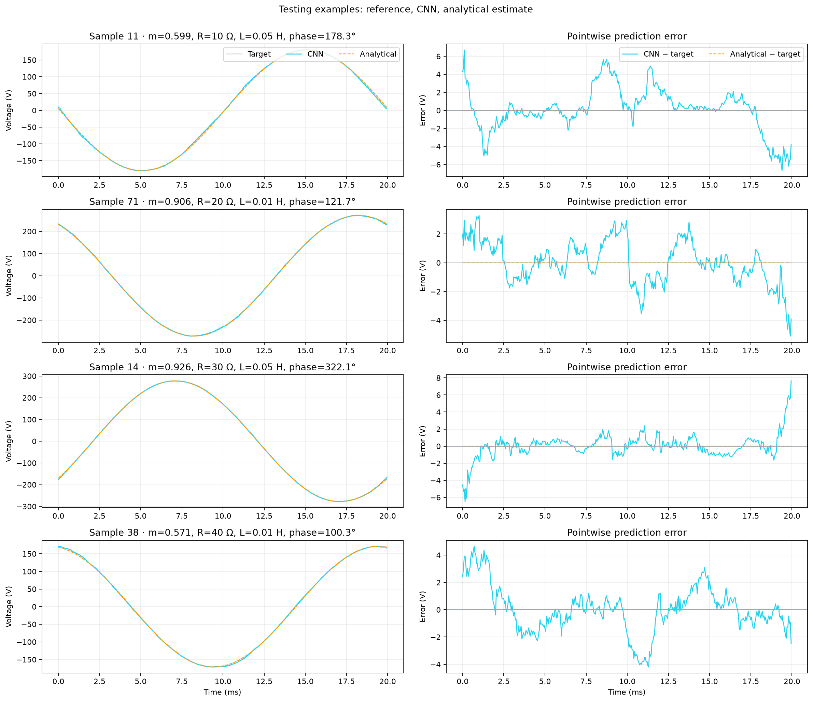
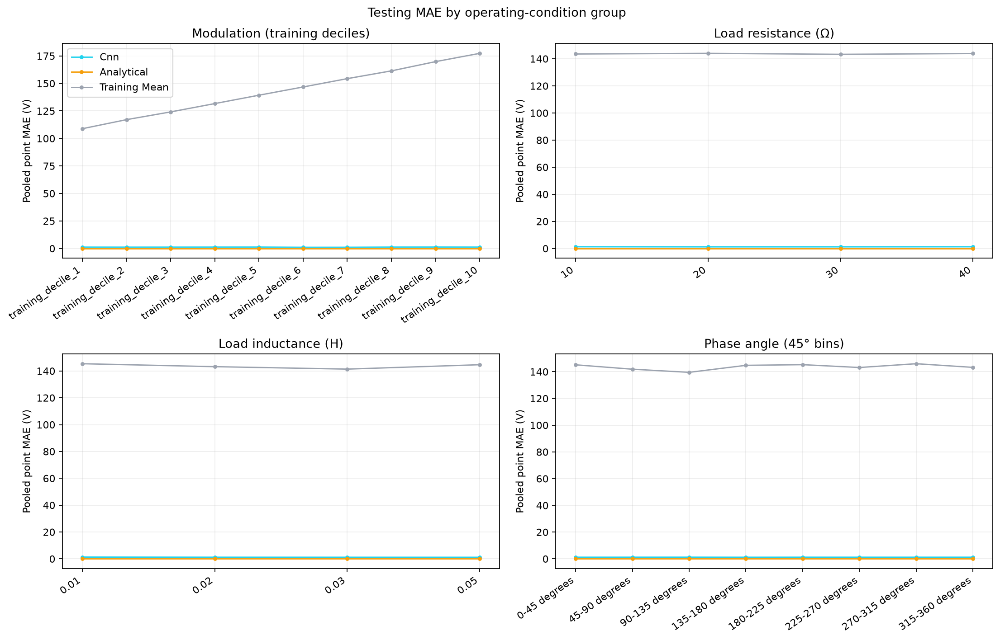
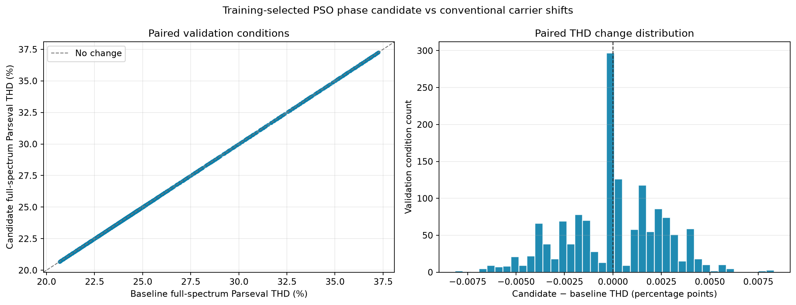

# Hybrid CNN and PSO-Based Harmonic Reduction in a Seven-Level Multilevel Inverter

## 1. Abstract

This report consolidates the project's electrical-model audit, saved-checkpoint
evaluation, CNN-versus-analytical comparison, PSO design and validation, and
software exhibition acceptance evidence. The software contains an ideal,
three-cell cascaded H-bridge inverter simulator, a trained residual CNN that
predicts a target/reference voltage waveform, an event-based Fourier evaluator,
a phase-aware particle-swarm optimizer, and a Streamlit demonstration.

The supplied dataset contains 10,000 aligned records with 400 samples per
waveform: 7,000 training, 1,500 validation, and 1,500 testing records. The
saved CNN checkpoint has 201,601 parameters and was selected at epoch 98 using
validation loss. On all 1,500 held-out test records (600,000 waveform points),
the CNN achieved pooled MAE 1.224758 V and RMSE 1.622291 V. The known
analytical sinusoidal reference achieved pooled MAE 0.0000134 V and RMSE
0.0000179 V on the same records. The CNN therefore does not improve on this
analytical target calculation.

A training-selected phase-shift PSO candidate was compared with the
conventional carrier offsets `[0°, 60°, 120°]` on all 1,500 validation
conditions. Mean full-spectrum Parseval THD changed from 26.280628% to
26.280678%, a slight deterioration of 0.00004996 percentage points. The
candidate maintained fundamental tracking within the configured constraint,
but the experiment does not support a harmonic-reduction claim.

The results establish reproducibility within the project's ideal software
model and supplied data. They do not establish equivalence to the absent
original MATLAB generator, Simulink or hardware behavior, offline operation
with the network disconnected, or physical harmonic reduction.

## 2. Introduction

Multilevel inverters synthesize stepped AC voltage from multiple DC sources.
Phase-shifted carrier PWM can distribute switching events among cells, while
Fourier analysis provides a way to quantify voltage harmonics. This project
combines an ideal seven-level inverter simulation, a waveform-prediction CNN,
and PSO-based carrier-phase search.

The central scientific question is whether the CNN or phase optimization
provides a measurable advantage beyond established computations. This report
therefore distinguishes three separate tasks:

1. Reconstructing the project's stored inverter signals in an ideal software
   model.
2. Predicting the dataset's reference waveform with a trained CNN versus
   calculating it analytically.
3. Comparing carrier-phase settings by output-voltage THD under the same
   simulator and metric definitions.

Evidence and qualifications are drawn from the [electrical model audit](./ELECTRICAL_MODEL_AUDIT.md),
[held-out CNN evaluation notes](./evaluation/CNN_TEST_EVALUATION.md),
[CNN-versus-analytical evaluation](./CNN_VS_ANALYTICAL_EVALUATION.md),
[PSO design](./OPTIMIZATION_DESIGN.md),
[multi-condition PSO validation](./PSO_MULTI_CONDITION_VALIDATION.md), and
[exhibition acceptance report](./FINAL_EXHIBITION_ACCEPTANCE_REPORT.md).

## 3. Problem Statement

The engineering objective is to study waveform prediction and harmonic
performance for a three-cell, seven-level cascaded H-bridge inverter. The
project's dataset and software provide an experimental framework, but the
scientific value of each method must be measured independently:

- The CNN is trained to predict a reference/target voltage waveform from
  voltage, current, and operating conditions.
- The inverter simulator calculates switching states, output voltage, and
  RL-load current using an idealized model.
- The phase-shift PSO searches carrier offsets to minimize a defined output
  voltage THD metric while preserving fundamental tracking.

The project title should not be read as proof that the CNN controls switching
gates or that the PSO reduces physical inverter harmonics. Those claims are
not supported by the model's interfaces or the measured validation results.

## 4. Objectives

The consolidated objectives and their evidence status are:

| Objective | Status | Evidence |
|---|---|---|
| Reproduce stored ideal switching signals and RL current | Verified against supplied dataset | Simulator and dataset comparisons described in the [electrical model audit](./ELECTRICAL_MODEL_AUDIT.md). |
| Load and evaluate the existing trained CNN without retraining | Verified | Strict checkpoint load and inference-only evaluation on the saved model. |
| Compare CNN and analytical reference on held-out records | Verified | All 1,500 test records evaluated; analytical reference is substantially more accurate. |
| Search relative carrier phases and preserve fundamental tracking | Implemented and evaluated in the ideal model | Circular PSO and hard tracking constraint; no validation THD improvement. |
| Demonstrate the workflow through the existing Streamlit interface | Verified for the documented acceptance run | Local launch, live simulation, PSO repeatability, and export-content checks. |
| Establish MATLAB, Simulink, hardware, or disconnected-network validity | Not verified | Original MATLAB source and independent physical/simulator validation were unavailable; network was not disconnected. |

## 5. Seven-Level Cascaded H-Bridge Inverter Architecture

The declared topology has three series-connected H-bridge cells. Each cell has
one 100 V DC source and four switches, giving 12 gate signals in total. The
cell state is represented as \(s_j \in \{-1,0,+1\}\), where \(j\) indexes the
three cells. The ideal output is

\[
v_o(t) = 100\sum_{j=1}^{3}s_j(t)\ \text{V},
\]

so the allowed output levels are \(-300,-200,-100,0,100,200,300\) V.

The simulator's gate ordering is `[S1,S2,S3,S4]` per cell. Its state mapping
is:

| Cell state | Gate pattern |
|---:|---|
| +1 | `[1, 0, 0, 1]` |
| 0 | `[0, 1, 0, 1]` |
| -1 | `[0, 1, 1, 0]` |

The simulator checks that gates reconstruct the cell state, prevents
simultaneous-on patterns in the checked same-leg pairs, and confirms that the
summed voltage remains in the seven allowed levels. These are sampled logic
checks; they do not model dead time, switching transients, gate-driver
behavior, or semiconductor constraints.

The implemented carrier offsets default to `[0°, 60°, 120°]`. The simulator
uses the owner-provided switching conventions and reproduces the stored
dataset's states and gates as detailed in Section 7. The original MATLAB
generator was not found, so this is not a line-by-line verification against
that source.

## 6. Dataset Description and Preprocessing

The extracted dataset and [configuration table](./data/raw/Seven_Level_Inverter_Project_extracted/Configuration.csv)
declare the following:

| Property | Value |
|---|---:|
| Dataset records | 10,000 |
| Training / validation / testing | 7,000 / 1,500 / 1,500 |
| Samples per waveform | 400 |
| Fundamental frequency | 50 Hz |
| Carrier frequency | 1 kHz |
| Sampling frequency | 20 kHz |
| DC source voltage | 100 V per cell |
| Cells / switches / output levels | 3 / 12 / 7 |
| Reported maximum harmonic order | 100 |

The aligned tables include input voltage, target voltage, load current,
operating conditions, cell states, switching gates, THD records, and split
labels. Operating-condition features are modulation index, load resistance,
load inductance, and phase angle. The reported training support is modulation
index 0.55–0.95, resistance values 10–40 \(\Omega\), inductance values
0.01–0.05 H, and phase coverage across 0–360 degrees. These ranges describe
the supplied records, not validated extrapolation limits.

Preprocessing aligns the primary waveforms and condition rows by `SampleID`.
The split labels are retained. Means and standard deviations for input voltage,
load current, four operating features, and target voltage are calculated from
training records only; the same statistics are used to normalize the other
splits and to denormalize predictions. The recorded train, validation, and
test IDs are disjoint, and the audit reported zero exact train/test duplicate
input records under its stated equality check.

The extracted project does not include the original MATLAB/Simulink dataset
generator. The supplied CSVs can support reconstruction checks, but they do
not alone establish how the original generator produced every signal or
whether records represent statistically independent physical experiments.

## 7. Electrical Simulation Model

The current simulator is implemented in
[inverter_simulator.py](./multilevel/inverter_simulator.py). It generates one
half-open 50 Hz cycle with 400 samples at 20 kHz. The normalized sinusoidal
reference is

\[
r(t)=m\sin(2\pi 50t+\theta),
\]

where \(m\) is modulation index and \(\theta\) is reference phase. Each cell
uses a 1 kHz triangular carrier with its configured phase offset. The state
logic compares the reference and its negative against each carrier, then maps
the result to the three-level cell states and corresponding gates.

The model is ideal and sampled. It does not represent DC-source variation,
switch voltage drops, dead time, parasitic elements, switching/conduction
losses, thermal limits, measurement noise, or hardware protection behavior.
The implemented conventions were supplied for this project; absent source
MATLAB code means their provenance cannot be independently checked.

## 8. CNN Architecture and Waveform Prediction

The saved model is `WaveformResidualCNN`, defined in
[cnn_model.py](./models/cnn_model.py) and constructed through the model
factory. It has separate one-dimensional residual branches for the 400-point
input-voltage and load-current waveforms. The branches use 32 and 64 channels.
The four normalized operating features pass through a width-32 condition
encoder. The branch and condition features are fused into 64-channel residual
blocks and projected to a 400-point output. The checkpoint contains **201,601
parameters**.

The input is normalized input voltage, normalized load current, and normalized
operating conditions. The output is a normalized target/reference voltage
waveform, denormalized with the checkpoint's training-derived target
statistics. The CNN does **not** predict cell states, switching gates, or
optimized output THD, and it is not connected as a gate controller.

The selected checkpoint is
[`best.pt`](./colab_runs/baseline_20261120_080836/checkpoints/best.pt), from
epoch 98 (one-based; zero-based epoch index 97). The trainer accepts separate
training and validation loaders, selects the best checkpoint by validation
loss, and does not accept a test loader in its training method. The audit
reported that the checkpoint architecture and normalization metadata match
the current model and training-only preprocessing. No retraining or
fine-tuning was used for this report.

Checkpoint SHA-256 recorded by the comparison run:

```text
9ffea39995c4bbba15f1f3572c9aaf54d49ad6ff1b1a186c4cafffe38263636c
```

## 9. CNN vs Analytical Reference Evaluation

The existing analytical reference uses modulation index and phase angle:

\[
v_{\text{ref}}[n] = 300m\sin\left(2\pi 50\frac{n}{20000}+\theta\right),
\quad n=0,\ldots,399.
\]

It does not use target waveform values to produce its predictions. This
equation reproduces the stored target to a maximum residual on the order of
\(10^{-4}\) V or less in the evaluation; the electrical audit also reported a
full-dataset residual near floating-point precision. Because the source
generator is absent, that match does not prove that the original MATLAB code
used the same exact expression.

The saved checkpoint was loaded strictly and evaluated in inference mode.
Metrics below are **pooled across all waveform points** within each split;
they are not averages of per-record values. Training and validation values
are descriptive/model-comparison results. Test results are final held-out
reporting only.

| Split | Predictor | MAE (V) | RMSE (V) | \(R^2\) | Correlation | Max absolute error (V) |
|---|---|---:|---:|---:|---:|---:|
| Training | CNN | 1.200522 | 1.594277 | 0.9999016 | 0.9999508 | 20.004890 |
| Training | Analytical | 0.0000135 | 0.0000179 | ~1.000000 | ~1.000000 | 0.0000897 |
| Training | Training-mean waveform | 143.022472 | 160.703160 | 0.0000760 | 0.008716 | 286.938711 |
| Validation | CNN | 1.227738 | 1.627304 | 0.9998982 | 0.9999491 | 14.992287 |
| Validation | Analytical | 0.0000139 | 0.0000185 | ~1.000000 | ~1.000000 | 0.0000937 |
| Validation | Training-mean waveform | 143.586732 | 161.306256 | -0.0001525 | -0.004438 | 286.912305 |
| Testing | CNN | 1.224758 | 1.622291 | 0.9998990 | 0.9999495 | 13.209122 |
| Testing | Analytical | 0.0000134 | 0.0000179 | ~1.000000 | ~1.000000 | 0.0000927 |
| Testing | Training-mean waveform | 143.661357 | 161.415636 | 0.0001794 | 0.014676 | 286.628460 |

The final test set comprised **1,500 records × 400 points = 600,000 points**.
For the CNN, mean and median per-record MAE were 1.224758 V and 1.184865 V;
mean and median per-record RMSE were 1.576753 V and 1.529406 V. These macro
statistics are distinct from pooled RMSE (1.622291 V). The validation
comparison selected the analytical predictor as the best fixed predictor by
pooled RMSE; no test result was used for that selection.

The CNN-versus-analytical report also groups results by modulation-index
training decile, resistance, inductance, and 45-degree phase bins. CNN errors
remain roughly in the 1.1–1.3 V MAE range across the reported test groups,
while analytical errors are around \(10^{-5}\) V. This describes the observed
test conditions only; it does not prove performance outside their support.

The CNN offers no measured prediction-accuracy advantage over calculating the
known analytical target. Its high \(R^2\) is not evidence of switching control
or harmonic reduction.





## 10. Particle Swarm Optimization Methodology

The existing phase-aware PSO keeps cell 1 fixed at 0 degrees and searches the
relative offsets of cells 2 and 3. Angles wrap modulo 360 degrees, and the
interchangeable cell phases are canonicalized by sorting. The conventional
baseline is `[0°, 60°, 120°]`.

The research optimization used the existing ideal switching/event evaluator
and minimized mean full-spectrum Parseval THD over a fixed 30-record
training-only subset, subject to a 0.05% maximum fundamental phasor tracking
error. The subset was selected across five modulation quantiles and six
circular phase bins. It contained the observed resistance and inductance
categories, but was not directly stratified by both load variables.

The saved training experiment used 20 seeds (20261120–20261139), 20 particles,
and 50 iterations per seed, with inertia 0.7298, cognitive/social coefficients
1.49618/1.49618, and 72-degree maximum velocity. The baseline was retained as
an incumbent. The selected seed was **20261139**. Across the saved runs the
experiment recorded 20,400 objective requests, 19,596 unique candidate
evaluations, 587,880 record evaluations, and 4,618.45 seconds total runtime.

The selected candidate was `[0°, 60.0780984597°, 120.0326906390°]`. Its
training-subset mean THD was 26.356343238%, versus 26.356355451% for the
baseline, a tiny training change of -0.00001221 percentage points. This is
training-set optimization evidence, not the final generalization result.

## 11. Multi-Condition PSO Validation

The fixed, training-selected candidate was evaluated against the conventional
baseline on the complete **1,500-condition validation split**. Both phase
sets used the same modulation, phase, switching model, Fourier implementation,
and evaluation conditions. Validation was not used to select the candidate.
No test records were loaded for PSO or this validation.

The objective and simulator calculate output-voltage harmonics from
modulation, reference phase, and carrier phase. In this ideal model, load
resistance and inductance affect the simulated current but not the switched
output voltage used by this PSO objective. Their presence in the validation
records therefore documents coverage; it does not demonstrate load-dependent
voltage-THD optimization.

| Validation statistic | Result |
|---|---:|
| Conditions evaluated | 1,500 |
| Mean baseline full-spectrum Parseval THD | 26.280627984% |
| Mean candidate full-spectrum Parseval THD | 26.280677944% |
| Mean candidate-minus-baseline change | +0.000049960 percentage points |
| Mean relative change | +0.000225422% |
| Median paired THD change | +0.000043371 percentage points |
| Minimum / maximum paired change | -0.008148487 / +0.008316529 percentage points |
| Sample standard deviation of paired change | 0.002542787 percentage points |
| Improved / unchanged / worsened conditions | 706 / 0 / 794 |
| Mean baseline / candidate fundamental peak | 225.531877 / 225.531877 V |
| Maximum candidate phasor tracking error | \(2.8431\times10^{-13}\)% |
| Configured maximum tracking error | 0.05% |

Percentage-point change is candidate THD percent minus baseline THD percent.
Relative change is calculated as `(candidate / baseline - 1) × 100%`.
Although 706 individual validation rows decreased slightly, 794 worsened and
the mean paired change was positive. The candidate maintained fundamental
tracking, but the result does **not** demonstrate a meaningful average
harmonic reduction.



## 12. Fourier Analysis and THD Calculation

The project has distinct Fourier/THD results that must not be conflated:

1. **Event-based full-spectrum Parseval THD:** switching transitions are
   solved as continuous event times, and voltage is integrated over
   piecewise-constant intervals. The total AC energy after removing the mean
   and fundamental is compared with the fundamental RMS value. This accounts
   for residual harmonic energy across the full spectrum and is the objective
   used for the multi-condition PSO validation.
2. **Event-based finite-band THD:** harmonic amplitudes are also explicitly
   calculated for orders 1–100. The ratio using orders 2–100 is a band-limited
   metric, not the full-spectrum Parseval result.
3. **Sampled finite-band THD:** the sampled waveform and configured FFT
   calculate a separate metric through the selected harmonic order. Sampling,
   finite-band truncation, and event integration make this result distinct
   from the continuous-time full-spectrum result.

For reference, the exhibition acceptance report's default live point
(\(m=0.75\), \(R=30\,\Omega\), \(L=0.03\) H, phase \(0^\circ\)) reported
24.723479% full-spectrum Parseval THD, approximately
0.000000102% event-based THD for orders 2–100, and 10.871% sampled finite-band
THD for orders 2–100. Their large differences are a reason to state the
method, frequency range, and sampling assumptions with every THD value; they
are not interchangeable measures.

The PSO comparison uses the same full-spectrum event-based definition for
baseline and candidate. The saved per-condition CSV also provides individual
harmonic amplitudes for orders 2–100. These software metrics are not a
measurement standard certification or a hardware THD result.

## 13. RL Load Modelling

The ideal load is a series \(R\)-\(L\) circuit driven by the simulated
piecewise-constant inverter output. For sample interval \(\Delta t\), the
exact zero-order-hold update is

\[
\alpha=e^{-R\Delta t/L}, \qquad
\beta=\frac{1-\alpha}{R}, \qquad
i[k+1]=\alpha i[k]+\beta v_o[k].
\]

The simulator calculates a periodic initial current so that the 400-sample
cycle is in periodic steady state, rather than starting at zero current.
The dataset audit reported generated gates and cell states matching all
10,000 records, gate-derived output voltage matching the stored input-voltage
records, and current agreement within floating-point precision (reported
RMSE approximately \(2.35\times10^{-14}\) A and maximum absolute error
approximately \(1.83\times10^{-13}\) A).

This is an ideal discrete-time load model. It does not imply load-dependent
output-voltage switching harmonics: in the current ideal PSO objective,
resistance and inductance change current, not the output voltage waveform
generated by carrier comparisons.

## 14. Software Architecture and Implementation

The verified workflow is organized around these existing components:

| Stage | Project component |
|---|---|
| Dataset reading, ID alignment, split handling, normalization | `preprocessing/data_loader.py`, `preprocessing/preprocess.py` |
| CNN definition and checkpoint-compatible factory | `models/cnn_model.py`, `models/model_factory.py` |
| Training and best-checkpoint selection | `training/trainer.py` |
| Seven-level PWM, gate, output-voltage, and RL-current simulation | `multilevel/inverter_simulator.py` |
| Live operating-point workflow and validation | `evaluation/live_simulation.py`, `evaluation/scientific_validation.py` |
| Held-out CNN evaluation | `evaluation/cnn_test_evaluator.py` |
| Event-based Fourier and THD | `evaluation/event_based_thd.py` |
| Circular carrier-phase PSO and saved experiment | `optimization/circular_phase_pso.py`, `optimization/phase_pso_experiment.py` |
| Paired multi-condition PSO validation | `evaluation/multi_condition_pso_validation.py` |
| User interface and local demonstrations | `app.py` |

The existing Streamlit dashboard was launched from outside the project folder
at `http://127.0.0.1:8503` in the acceptance run. The default live demo
produced the seven voltage levels, three cell states, twelve gate signals,
RL current, reference and CNN prediction arrays, and harmonic metrics. A
fixed-seed live PSO run was repeatable; the selected phases remained at the
baseline, so no improvement was claimed. CSV, JSON, and ZIP export content was
generated and the ZIP was opened and integrity-checked.

The acceptance report records 60 unit tests passing at that stage. After the
CNN-versus-analytical and multi-condition evaluation work was added, the full
documented command
`.\.venv\Scripts\python.exe -B -m unittest discover -s tests -v`
passed **66 tests**. The final consolidation itself changes documentation
only; no new tests were run for it.

The disconnected-network launch was **not tested**. The export bundle contents
were inspected, but the browser's final download-manager handoff was not
verified. Local application launch and export generation therefore should not
be described as proof of offline or browser-download readiness.

## 15. Experimental Results and Discussion

The main findings are:

1. **Dataset reconstruction:** the current ideal simulator reproduces the
   stored gate, state, voltage, and current signals to the reported
   tolerances. This is dataset consistency under the stated conventions, not
   independent physical validation.
2. **CNN prediction:** the CNN achieves high pooled \(R^2\) because its target
   is a smooth, deterministic waveform, but it is less accurate than the
   analytical calculation by several orders of magnitude in RMSE. The CNN
   does not add useful predictive accuracy for the present target task.
3. **PSO behavior:** the training-selected candidate has a tiny training-set
   THD decrease but a tiny mean validation-set increase. The comparison
   includes both improved and worsened conditions, with more worsened than
   improved. The outcome does not support a reduction claim.
4. **Fundamental tracking:** the candidate remains far inside the 0.05%
   tracking bound for the tested validation cases. Passing this constraint is
   not itself evidence of lower THD.
5. **THD interpretation:** event full-spectrum Parseval, event finite-band,
   and sampled finite-band results can differ substantially. Only paired
   results using the same definition support a fair baseline comparison.
6. **Role separation:** CNN target-waveform prediction is distinct from
   inverter switching simulation and PSO output-voltage analysis. CNN
   accuracy must not be used as evidence of harmonic improvement.

The reproducible outputs supporting these conclusions are
[CNN comparison summary and per-record/condition metrics](./results/cnn_vs_analytical_20261120_2209/summary.json),
[CNN comparison report](./CNN_VS_ANALYTICAL_EVALUATION.md),
[multi-condition PSO summary](./results/multi_condition_pso_validation_20261120_2230/summary.json),
[paired per-condition PSO results](./results/multi_condition_pso_validation_20261120_2230/per_condition_metrics.csv),
and [acceptance results](./FINAL_EXHIBITION_ACCEPTANCE_REPORT.md).

## 16. Limitations

- The original MATLAB/Simulink dataset-generation source is absent. The
  simulator reproduces the supplied data under the provided conventions, but
  no source-to-source MATLAB equivalence was established.
- No Simulink comparison, hardware test, or physical inverter measurement
  was performed.
- The inverter, switches, DC sources, and RL model are idealized; no dead
  time, parasitic effects, losses, thermal limits, or sensing errors are
  represented.
- The dataset's target is essentially the analytical sinusoid. This makes
  the current CNN target task redundant and does not test a candidate-aware
  control surrogate.
- The CNN's reported generalization applies only to the existing held-out
  split and observed conditions. It does not establish robustness to
  measurement noise, unseen combinations, or extrapolation.
- The PSO candidate was optimized on a 30-record training subset. Validation
  shows a minute average deterioration. The existing voltage-THD objective
  does not depend on load resistance or inductance.
- The validation records may be synthetic or correlated; condition counts
  should not be interpreted as independent physical trials.
- Offline readiness with networking disabled was not tested. Browser download
  completion was also not independently confirmed.
- The trained checkpoint and source artifacts are tied to the saved
  preprocessing metadata. Any future evaluation must retain strict
  checkpoint loading, training-only normalization, and split isolation.

## 17. Conclusion

The project is a functional software demonstration of an ideal seven-level
inverter model, RL-load recurrence, saved CNN waveform inference, Fourier
analysis, circular phase PSO, and local result export. Its simulator
reconstructs the provided dataset consistently, and the saved checkpoint can
be evaluated without retraining.

The measured research results do not support claiming that the current CNN
improves on the analytical reference or that the selected PSO phase candidate
reduces validation THD. The CNN is less accurate than the known analytical
target, while the PSO candidate slightly worsens mean validation THD despite
preserving fundamental tracking. Consequently, the scientifically defensible
project conclusion is that the software workflow is implemented and
reproducible under its ideal-model assumptions, but harmonic reduction has
not been demonstrated by the reported validation experiment.

## 18. Future Scope

Recommended next steps, without changing the present results, are:

1. Obtain and preserve the authoritative MATLAB source and compare each
   switching, gate, timing, and RL-model convention against it.
2. Decide whether the CNN should remain as a reference-waveform demonstration
   or be replaced in future work by a genuinely candidate-aware, simulator-
   generated surrogate. Any new model would require separate training,
   validation, test isolation, uncertainty checks, and exact-simulator
   confirmation.
3. Revisit the phase-optimization objective only through a preregistered,
   scientifically justified study. Keep a disjoint final evaluation set,
   use paired baseline/candidate conditions, preserve fundamental tracking,
   and report exact metric definitions and variability.
4. If load-dependent harmonic claims are desired, define and validate a model
   in which the relevant output metric depends on load behavior; do not infer
   such dependence from resistance/inductance columns alone.
5. Compare the ideal simulation against an independent circuit simulator and,
   if feasible, calibrated hardware measurements before making physical
   claims.
6. Test launch and export behavior with network access actually disabled
   before describing the application as offline-verified.

## References and Reproducibility

Project evidence and machine-readable artifacts:

- [Electrical model audit](./ELECTRICAL_MODEL_AUDIT.md)
- [CNN held-out evaluation methodology](./evaluation/CNN_TEST_EVALUATION.md)
- [CNN-versus-analytical report](./CNN_VS_ANALYTICAL_EVALUATION.md)
- [CNN comparison JSON summary](./results/cnn_vs_analytical_20261120_2209/summary.json)
- [CNN per-record metrics](./results/cnn_vs_analytical_20261120_2209/per_record_metrics.csv)
- [Optimization design](./OPTIMIZATION_DESIGN.md)
- [Multi-condition PSO validation report](./PSO_MULTI_CONDITION_VALIDATION.md)
- [PSO validation JSON summary](./results/multi_condition_pso_validation_20261120_2230/summary.json)
- [PSO per-condition metrics and harmonics](./results/multi_condition_pso_validation_20261120_2230/per_condition_metrics.csv)
- [Training-selected PSO phase results](./results/multi_condition_pso_validation_20261120_2230/phase_shift_results.json)
- [Exhibition acceptance report](./FINAL_EXHIBITION_ACCEPTANCE_REPORT.md)
- [Dataset configuration](./data/raw/Seven_Level_Inverter_Project_extracted/Configuration.csv)
- [Simulator source](./multilevel/inverter_simulator.py)
- [Event-based Fourier/THD source](./evaluation/event_based_thd.py)
- [CNN model source](./models/cnn_model.py)

The CNN comparison used the existing checkpoint and CPU inference, with
training-fitted normalization and the complete split labels. The PSO
validation reused the saved training-only candidate and evaluated the full
validation split without loading test records. Reports and result artifacts
retain the experiment metadata, metrics, and plots needed to reproduce or
audit the stated findings.
