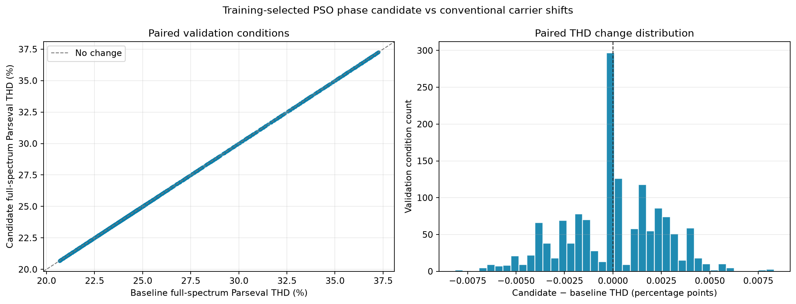

# Multi-Condition PSO Validation

**Run:** 2026-11-20T22:24:19.285067+05:30  
**Validation conditions:** 1,500 (the complete labeled validation split)  
**Source training-only PSO experiment:** `C:\Users\tejas m naidu\OneDrive\Hybrid_CNN_Inverter_Optimization-20261120T100441Z-1-001\Hybrid_CNN_Inverter_Optimization\results\circular_phase_pso_20261120_183109`  
**Reproducible outputs:** [`results/multi_condition_pso_validation_20261120_2230/`](./results/multi_condition_pso_validation_20261120_2230/)

## Objective and scientific limitation

This experiment compares the conventional carrier phases `[0°, 60°, 120°]` with one globally selected training-only circular-PSO candidate on a fixed validation population. It does not tune on validation or use the held-out testing split.

The existing event-based voltage-THD objective takes modulation index, reference phase, and carrier phase offsets. The ideal output-voltage switching model is independent of load resistance and inductance; R and L therefore do not enter this objective. They are retained in each validation row and their categories are described, but this experiment does **not** establish load-dependent voltage-THD optimization. The existing candidate selection stratifies training records by modulation-index quantile and reference-phase bin, not by R/L; its selected 30 records nevertheless contain all observed R and L categories.

## Methodology and split policy

- Baseline: cell carriers `[0°, 60°, 120°]`.
- Candidate: `[0°, 60.0780984597°, 120.032690639°]`, fixed from the completed training-only experiment before this independent validation evaluation.
- Validation: every one of the 1,500 rows labeled `validation` in `Sample_Splits.csv`, each evaluated with both phase configurations under identical modulation and phase. R/L are recorded without influencing the electrical THD computation.
- Training: used only through the saved 30-record stratified training subset and previously completed PSO study to select the global candidate. No PSO run was fit or selected against validation values in this validation run.
- Testing: no test operating-condition values or waveforms were parsed or evaluated. The saved source PSO metadata reports zero testing records evaluated.
- CNN, dataset values, and saved experiment artifacts were read-only. This validation writes a new uniquely named results folder.

## PSO configuration and provenance

- Seed runs: 20 seeds, `20261120` through `20261139`; selected seed **20261139**.
- Swarm: 20 particles × 50 iterations per seed; inertia 0.7298, cognitive/social 1.49618/1.49618, max velocity 72.0°.
- Variables: cell-2 and cell-3 carrier offsets, modulo 360°, canonicalized by sorting; cell 1 remains fixed at 0°.
- Training subset: 30 training records, chosen by the saved 5 modulation quantiles × 6 circular phase bins. Baseline is retained as an incumbent.
- Historical optimization accounting: 20,400 objective requests, 19,596 unique candidate evaluations, 587,880 training-record evaluations, and 4618.450 seconds summed over all saved seeded runs.
- Candidate's training-subset mean THD: 26.356343238% vs baseline 26.356355451% (training change -1.22131486e-05 pp).
- Hard fundamental phasor tracking limit: 0.05%.

The evaluation uses `evaluate_event_based_thd` identically for baseline and candidate. Its **full-spectrum Parseval THD** is based on continuous event intervals and total AC energy after removing the DC mean and fundamental. It is not the event evaluator's finite harmonic-band THD or its sampled 20 kHz THD. Individual event Fourier amplitudes for orders 2–100 are included in `per_condition_metrics.csv`; the full-spectrum THD statistic is not limited to those listed harmonics.

## Validation summary

Percentage-point change is `candidate THD (%) − baseline THD (%)`. Relative percentage change is `(candidate / baseline − 1) × 100%`; negative values indicate lower candidate THD. “Unchanged” uses an absolute tolerance of 1.0e-10 percentage points. Standard deviation is sample standard deviation (`ddof=1`).

| Metric | Value |
|---|---:|
| Validation operating conditions | 1,500 |
| Mean baseline full-spectrum Parseval THD | 26.280627984% |
| Mean candidate full-spectrum Parseval THD | 26.280677944% |
| Mean candidate − baseline change | +4.99598405e-05 percentage points |
| Mean relative THD change | +0.000225421946% |
| Median paired THD change | +4.33705463e-05 percentage points |
| Minimum / maximum paired THD change | -0.00814848655 / +0.00831652929 percentage points |
| Sample standard deviation of paired change | 0.0025427866 percentage points |
| Improved / unchanged / worsened conditions | 706 / 0 / 794 |
| Mean baseline / candidate fundamental peak | 225.531877377 / 225.531877377 V |
| Mean target fundamental peak | 225.531877377 V |
| Mean baseline / candidate phasor tracking error | 8.60919299e-14% / 8.68635901e-14% |
| Mean baseline / candidate fundamental amplitude error | 5.40012829e-14% / 5.5231609e-14% |
| Maximum candidate phasor tracking error | 2.8430553e-13% (limit 0.05%) |

### Condition-group breakdown

The objective does not depend on these load categories; the table documents validation coverage rather than asserting load sensitivity.

| Group | Conditions | Mean baseline THD (%) | Mean candidate THD (%) | Mean change (percentage points) |
|---|---:|---:|---:|---:|
| Modulation decile 0.550–0.591 | 137 | 35.881078526 | 35.881051903 | -2.662296e-05 |
| Modulation decile 0.591–0.630 | 127 | 32.627438640 | 32.627656528 | +0.000217887222 |
| Modulation decile 0.630–0.670 | 179 | 28.552904052 | 28.552912213 | +8.16124981e-06 |
| Modulation decile 0.670–0.710 | 153 | 25.695410614 | 25.694929247 | -0.000481367625 |
| Modulation decile 0.710–0.750 | 154 | 24.865233508 | 24.865368196 | +0.0001346872 |
| Modulation decile 0.750–0.788 | 135 | 24.586188228 | 24.586454425 | +0.000266196843 |
| Modulation decile 0.788–0.826 | 158 | 24.260887807 | 24.261035820 | +0.000148013355 |
| Modulation decile 0.826–0.867 | 144 | 23.718997226 | 23.718757665 | -0.000239560526 |
| Modulation decile 0.867–0.909 | 159 | 22.760218920 | 22.760253892 | +3.49716639e-05 |
| Modulation decile 0.909–0.950 | 154 | 21.449154594 | 21.449621967 | +0.000467373508 |
| Load resistance 10 Ω | 339 | 26.381198770 | 26.381242469 | +4.36987395e-05 |
| Load resistance 20 Ω | 386 | 26.373526301 | 26.373577645 | +5.13437598e-05 |
| Load resistance 30 Ω | 393 | 26.112569757 | 26.112569520 | -2.36903911e-07 |
| Load resistance 40 Ω | 382 | 26.270404518 | 26.270510278 | +0.000105759947 |
| Load inductance 0.01 H | 375 | 25.864193309 | 25.864387741 | +0.000194432868 |
| Load inductance 0.02 H | 378 | 26.248826136 | 26.248805628 | -2.05084151e-05 |
| Load inductance 0.03 H | 381 | 26.337155403 | 26.337223865 | +6.84622756e-05 |
| Load inductance 0.05 H | 366 | 26.681303270 | 26.681258722 | -4.45478437e-05 |
| Reference phase 0-45 degrees | 199 | 26.341928296 | 26.341878068 | -5.02283102e-05 |
| Reference phase 45-90 degrees | 178 | 26.740755241 | 26.740706029 | -4.92121575e-05 |
| Reference phase 90-135 degrees | 193 | 26.162822982 | 26.163011714 | +0.00018873171 |
| Reference phase 135-180 degrees | 190 | 26.438228803 | 26.438230116 | +1.31366607e-06 |
| Reference phase 180-225 degrees | 191 | 26.228554917 | 26.228567237 | +1.23200458e-05 |
| Reference phase 225-270 degrees | 191 | 26.185924063 | 26.186075411 | +0.000151348189 |
| Reference phase 270-315 degrees | 169 | 26.023414940 | 26.023852091 | +0.000437151373 |
| Reference phase 315-360 degrees | 189 | 26.122925363 | 26.122670765 | -0.000254598271 |

### Per-condition examples

The complete 1,500 paired rows are in [`per_condition_metrics.csv`](./results/multi_condition_pso_validation_20261120_2230/per_condition_metrics.csv). First eight rows by SampleID:

| SampleID | m | R (Ω) | L (H) | Phase (°) | Baseline THD (%) | Candidate THD (%) | Δ (pp) | Relative Δ (%) |
|---:|---:|---:|---:|---:|---:|---:|---:|---:|
| 13 | 0.76868 | 40 | 0.05 | 66.5476 | 24.612183871 | 24.615000534 | +0.00281666323 | +0.0114441825 |
| 20 | 0.85851 | 20 | 0.01 | 26.6561 | 23.529890623 | 23.531396649 | +0.00150602608 | +0.0064004806 |
| 23 | 0.90489 | 10 | 0.03 | 169.9974 | 22.303216207 | 22.305353793 | +0.00213758619 | +0.00958420601 |
| 29 | 0.92188 | 30 | 0.05 | 290.9233 | 21.716249136 | 21.716262571 | +1.3434978e-05 | +6.18660154e-05 |
| 32 | 0.64117 | 40 | 0.05 | 153.7588 | 29.672003757 | 29.672120792 | +0.000117035294 | +0.000394430034 |
| 37 | 0.66394 | 30 | 0.03 | 13.2793 | 27.258215440 | 27.260518577 | +0.00230313623 | +0.00844932875 |
| 42 | 0.58612 | 20 | 0.01 | 300.7089 | 34.625036428 | 34.626771682 | +0.00173525394 | +0.00501155844 |
| 49 | 0.91017 | 20 | 0.02 | 227.9165 | 22.147883844 | 22.146739081 | -0.00114476346 | -0.00516872615 |

## Fundamental tracking

The source PSO candidate was accepted under a hard maximum phasor-error constraint of 0.05%. On the full validation set, its maximum phasor tracking error was **2.8430553e-13%**. Thus it satisfies that constraint in these validation cases. The CSV also records baseline and candidate fundamental peak amplitude and amplitude-only error for every condition. Fundamental tracking does not by itself establish harmonic improvement.

## Scientific interpretation

The training-selected candidate worsened mean full-spectrum Parseval THD on the fixed validation set. This experiment does not support a harmonic-reduction claim.

This result applies to this ideal software model, the fixed dataset validation conditions, and the project's event-based Fourier definition. It does not establish hardware performance, MATLAB/Simulink agreement, load-dependent THD effects, statistical independence of nearby/synthetic operating records, or generalization beyond the observed conditions. The dataset may contain synthetic records; condition-level counts should not be interpreted as independent physical experiments.
